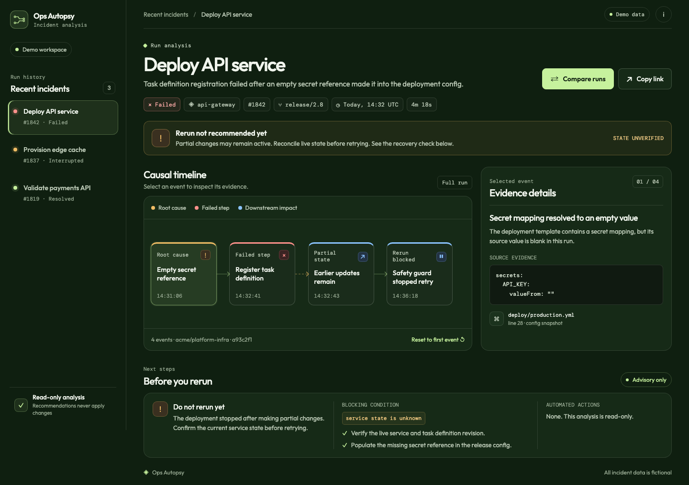

[Português](README.md) | [English](README.en.md)

# Ops Autopsy



Ops Autopsy is a static prototype for exploring visual software-delivery incident analysis: a causal timeline, evidence attached to events, and read-only recovery guidance.

> **Project status:** browser demonstration with fictional data. It is not yet an installable IDE plugin.

## What is implemented

- Three fictional demo scenarios: `deploy-api`, `infra-plan`, and `test-timeout`.
- An interactive timeline with event selection and related evidence.
- An illustrative comparison with a previous successful run; it does not query an external system.
- Recovery guidance displayed as text. The application does not run commands or modify systems.
- Direct links to a scenario through the URL fragment, for example `index.html#deploy-api`.
- Sharing the current URL through the clipboard when the browser allows it.

## Limitations and plugin status

The application consists of HTML, CSS, and JavaScript running in a browser. Scenarios are defined in `app.js`; there is no backend, IDE integration, extension manifest, authentication, or connection to real data sources. There is no operational integration with Orca, Azure DevOps, Git, or cloud providers. Examples and evidence are fictional and do not represent real incidents.

Turning this prototype into an installable plugin requires choosing the IDE and supported versions, the data source and its authorization model, and implementing the platform-specific manifest and integration. Do not put credentials or operational data into the examples.

## Run locally

A modern browser with JavaScript enabled is required. There is no need to install dependencies, use a package manager, or build the project.

1. Get a copy of the repository:

   ```sh
   git clone https://github.com/ineslino/ops-autopsy.git
   cd ops-autopsy
   ```

2. Open `index.html` in a browser. No server is required.

The Outfit and DM Mono fonts load from Google Fonts; without an internet connection, the browser uses the fallback fonts defined in CSS. Clipboard sharing depends on browser support and permissions.

## Usage example

The following fragments open the corresponding scenarios after opening `index.html`:

| Fragment | Demo scenario |
| --- | --- |
| `#deploy-api` | Delivery failure associated with an empty secret reference. |
| `#infra-plan` | Interrupted infrastructure apply with an uncertain outcome. |
| `#test-timeout` | A test timeout followed by a successful event. |

Explore a scenario by selecting timeline events and inspecting the displayed evidence. Use run comparison to see a fictional previous event; it does not query real history. The recommendations are informational and should not be executed automatically.

## Configuration and structure

There is no environment-variable configuration or credential setup. Demo data lives in the `incidents` list in `app.js`; only edit it with fictional information.

| File | Contents |
| --- | --- |
| `index.html` | Application structure and resource references. |
| `styles.css` | Presentation and responsive behaviour. |
| `app.js` | Scenarios, timeline, evidence, and interactions. |
| `favicon.svg` | Prototype icon. |
| `share.png` | Screenshot used in this documentation and social preview. |

## Validation

There is no automated test suite, build process, or CI pipeline configured. For a basic local check, with Node.js installed:

```sh
node --check app.js
git diff --check
```

Also manually check in a browser: open each scenario above, select events, inspect evidence, toggle run comparison, and verify the layout at narrow and wide viewport sizes.

## Contributing

Changes should preserve the demo's standalone, read-only nature and clearly distinguish fictional data from real integrations. Before proposing an integration, identify the intended IDE, version, and data source. Run the checks above and manually validate the interface before submitting a pull request to `main`. The repository does not define a release process or automated checks.

## Documentation

- [Repository metadata proposal](docs/repository-metadata.md) — confirmed current values and suggested topics, not yet applied.

## Licence

This project is licensed under the MIT License. See [LICENSE](LICENSE) for the terms.
