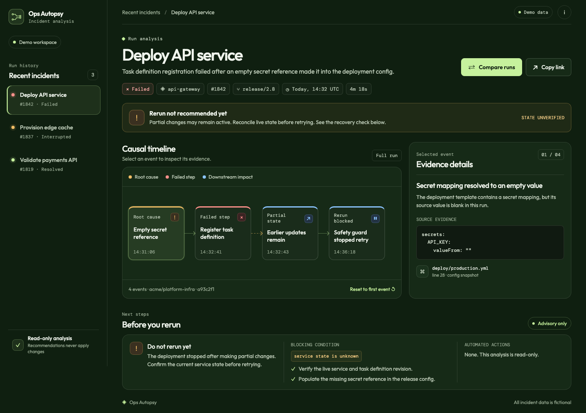

[Português](README.md) | [English](README.en.md)

# Ops Autopsy



O Ops Autopsy é um protótipo estático para explorar a análise visual de incidentes de entrega de software: uma linha temporal causal, evidência associada a eventos e recomendações de recuperação só de leitura.

> **Estado do projeto:** demonstração de navegador com dados fictícios. Ainda não é um plugin instalável para uma IDE.

## O que está implementado

- Três cenários de demonstração fictícios: `deploy-api`, `infra-plan` e `test-timeout`.
- Linha temporal interativa com seleção de eventos e respetiva evidência.
- Comparação ilustrativa com uma execução anterior bem-sucedida; não consulta um sistema externo.
- Recomendações de recuperação apresentadas como texto. A aplicação não executa comandos nem altera sistemas.
- Ligação direta a um cenário através do fragmento do URL, por exemplo `index.html#deploy-api`.
- Partilha do URL atual através da área de transferência, quando o navegador o permite.

## Limites e estado do plugin

A aplicação é composta por HTML, CSS e JavaScript executados no navegador. Os cenários estão definidos em `app.js`; não há backend, integração com IDE, manifesto de extensão, autenticação ou ligação a fontes reais de dados. Não existe integração operacional com Orca, Azure DevOps, Git ou fornecedores cloud. Os exemplos e as evidências são fictícios e não representam incidentes reais.

Para transformar este protótipo num plugin instalável, ainda é necessário decidir a IDE e as versões suportadas, a fonte de dados e a respetiva autorização, e implementar o manifesto e a integração específicos dessa plataforma. Não introduza credenciais ou dados operacionais nos exemplos.

## Executar localmente

É necessário um navegador moderno com JavaScript ativo. Não é necessário instalar dependências, usar um gestor de pacotes ou compilar o projeto.

1. Obtenha uma cópia do repositório:

   ```sh
   git clone https://github.com/ineslino/ops-autopsy.git
   cd ops-autopsy
   ```

2. Abra `index.html` num navegador. Não é necessário iniciar um servidor.

As fontes Outfit e DM Mono são carregadas do Google Fonts; sem ligação à Internet, o navegador usa as fontes alternativas definidas no CSS. A partilha pela área de transferência depende das permissões e do suporte do navegador.

## Exemplo de utilização

Os seguintes fragmentos abrem os cenários correspondentes depois de abrir `index.html`:

| Fragmento | Cenário de demonstração |
| --- | --- |
| `#deploy-api` | Falha de entrega associada a uma referência de segredo vazia. |
| `#infra-plan` | Aplicação de infraestrutura interrompida, com resultado incerto. |
| `#test-timeout` | Teste com timeout e evento de seguimento bem-sucedido. |

Para explorar um cenário, selecione eventos na linha temporal e consulte a evidência apresentada. Use a comparação de execuções para ver o evento anterior fictício; não é uma consulta ao histórico real. As recomendações são informativas e não devem ser executadas automaticamente.

## Configuração e estrutura

Não há configuração por variáveis de ambiente nem credenciais. Os dados de demonstração são a lista `incidents` em `app.js`; altere-a apenas com informação fictícia.

| Ficheiro | Conteúdo |
| --- | --- |
| `index.html` | Estrutura da aplicação e referências aos recursos. |
| `styles.css` | Apresentação e comportamento responsivo. |
| `app.js` | Cenários, linha temporal, evidências e interações. |
| `favicon.svg` | Ícone do protótipo. |
| `share.png` | Captura usada nesta documentação e na pré-visualização social. |

## Verificação

Não existe um conjunto de testes automatizados, processo de build ou pipeline de CI configurado. Para uma verificação local básica, com Node.js instalado:

```sh
node --check app.js
git diff --check
```

Verifique também manualmente no navegador: abrir cada cenário acima, selecionar eventos, consultar evidências, ativar e desativar a comparação, e testar a apresentação em ecrãs estreitos e largos.

## Contribuir

As alterações devem preservar o caráter autónomo e só de leitura da demonstração e distinguir claramente dados fictícios de integrações reais. Antes de propor uma integração, identifique a IDE, a versão e a fonte de dados pretendidas. Execute as verificações acima e valide manualmente a interface antes de submeter uma pull request para `main`. O repositório não define um processo de lançamento ou verificações automáticas.

## Documentação

- [Proposta de metadados do repositório](docs/repository-metadata.md) — valores actuais confirmados e tópicos sugeridos, ainda não aplicados.

## Licença

Este projeto está licenciado ao abrigo da licença MIT. Consulte o ficheiro [LICENSE](LICENSE) para ver os termos.
