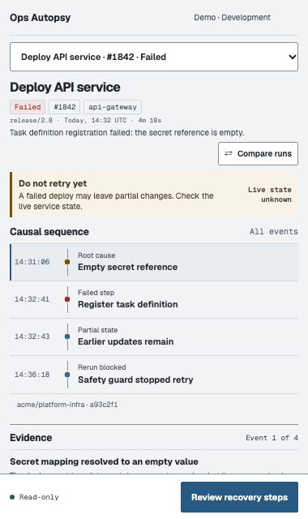

[Português](README.md) | [English](README.en.md)

# Ops Autopsy


O Ops Autopsy é uma extensão instalável para Visual Studio Code que apresenta uma análise visual e só de leitura de incidentes de entrega de software: linha temporal causal, evidência associada a eventos e orientações de recuperação.

> **Estado do projeto:** primeira extensão VS Code instalável, com cenários fictícios. Ainda não existem ligações a fornecedores nem análise de incidentes reais.

## Funcionalidades

- Abre o analisador visual numa vista Webview do VS Code através da Paleta de Comandos.
- Inclui três cenários fictícios: `deploy-api`, `infra-plan` e `test-timeout`.
- Permite selecionar eventos na linha temporal, consultar evidência e comparar uma execução anterior ilustrativa.
- Apresenta orientações de recuperação sem executar comandos ou alterar recursos.
- Permite configurar a fonte e os nomes do workspace e do ambiente. A única fonte disponível é `demo`.
- Mantém também uma versão autónoma para browser, sem necessidade de instalar a extensão.

Em ecrãs de PC, a navegação, a sequência causal e a evidência aparecem lado a lado. Em painéis estreitos, a interface muda para um seletor de execução e uma sequência vertical:



## Instalar no VS Code

É necessário o Visual Studio Code 1.85 ou posterior. Para construir o instalador localmente, é necessário Node.js 22 ou posterior e npm:

1. Instale as dependências de desenvolvimento e valide o projeto:

   ```sh
   npm ci
   npm test
   npm run check
   ```

2. Crie o pacote VSIX:

   ```sh
   npm run package
   ```

   O ficheiro gerado chama-se `ops-autopsy-0.1.0.vsix`.

3. Instale-o pela linha de comandos:

   ```sh
   code --install-extension ./ops-autopsy-0.1.0.vsix
   ```

   Em alternativa, no VS Code abra **Extensions**, escolha **…** e selecione **Install from VSIX…**.

4. Abra a Paleta de Comandos e execute **Ops Autopsy: Open Incident Analyzer**.

As definições do diálogo são guardadas no perfil de utilizador do VS Code em `opsAutopsy.preferences`. Só incluem `providerId`, `workspaceName` e `environmentName`; não aceitam nem guardam credenciais.

## Executar no browser

É necessário um browser moderno com JavaScript ativo. A partir da pasta do projeto, inicie um servidor estático:

```sh
python3 -m http.server 8000
```

Abra `http://localhost:8000`. A versão autónoma guarda os nomes não sensíveis no `localStorage` do browser. As fontes Outfit e DM Mono são carregadas do Google Fonts; sem ligação à Internet, são usadas as fontes alternativas definidas no CSS.

## Cenários e utilização

Abra `index.html` com um destes fragmentos para selecionar um cenário:

| Fragmento | Cenário |
| --- | --- |
| `#deploy-api` | Falha de entrega associada a uma referência de segredo vazia. |
| `#infra-plan` | Aplicação de infraestrutura interrompida, com resultado incerto. |
| `#test-timeout` | Teste com timeout e evento de seguimento bem-sucedido. |

Selecione eventos para consultar a evidência; use a comparação para ver um evento anterior fictício. As recomendações são informativas e não devem ser executadas automaticamente. Os cenários não representam incidentes reais nem consultam o histórico de uma plataforma.

## Integrações e limites

A extensão empacota a aplicação existente numa Webview do VS Code. O adaptador `demo` é a única fonte registada e fornece dados fictícios locais. Não há backend, autenticação, pedidos a APIs de incidentes nem conectores de dados a Azure DevOps, GitHub, cloud ou CI/CD; a integração atual com o VS Code limita-se à interface e às definições do utilizador. A interface e a extensão não executam, repetem, cancelam ou alteram execuções ou recursos.

O registo de adaptadores fornece uma base para futuras fontes escolhidas pelo utilizador, mas não representa uma integração já operacional. Uma integração real deverá usar armazenamento seguro da IDE para segredos e solicitar apenas permissões de leitura. Consulte [a arquitetura de integrações](docs/integrations.md).

## Estrutura e validação

| Ficheiro | Conteúdo |
| --- | --- |
| `package.json` | Manifesto da extensão, comando, preferências do utilizador e scripts de validação/empacotamento. |
| `extension.js` | Ativação, Webview e ligação às definições do VS Code. |
| `index.html`, `styles.css`, `app.js` | Interface, apresentação e cenários fictícios. |
| `integration-settings.js` | Registo de adaptadores e validação de preferências não sensíveis. |
| `tests/` | Testes unitários da configuração e da política da Webview. |
| `docs/integrations.md` | Estado, fronteiras de segurança e contrato para fontes futuras. |
| `share.png`, `panel-compact.png`, `favicon.svg` | Capturas desktop e compacta, e ícone da interface. |

`npm run package` executa `npm run check` e `npm test` antes de criar o VSIX. Não existe pipeline de CI nem publicação configurada para o VS Code Marketplace. Para contribuir, preserve o comportamento só de leitura, distinga sempre dados fictícios de reais e execute os testes antes de abrir uma pull request para `main`.

## Documentação e licença

- [Arquitetura de integrações](docs/integrations.md) — estado atual, configuração do utilizador, segurança e contrato para adaptadores.
- [Proposta de metadados do repositório](docs/repository-metadata.md) — tópicos sugeridos, não aplicados.
- [Licença MIT](LICENSE).
